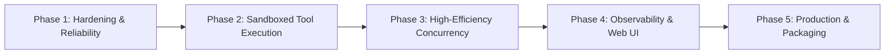
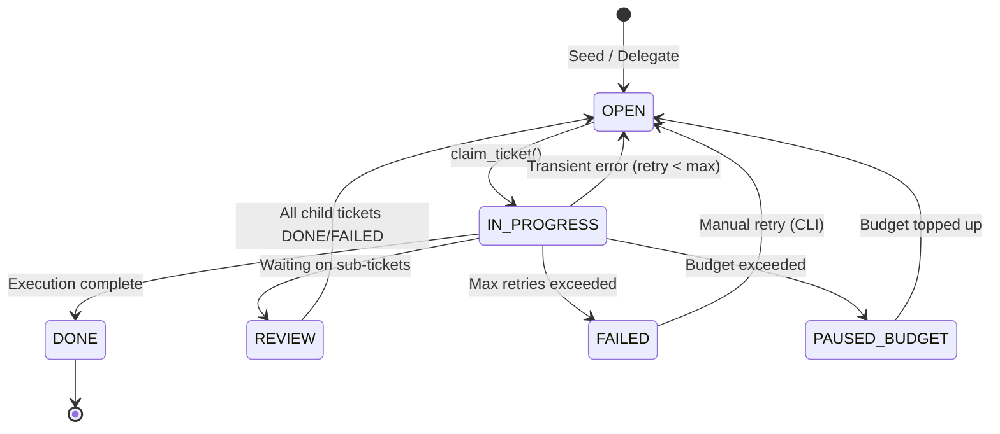

# Vectis: The Way Forward
**Strategic Product & Engineering Roadmap (v0.2.0 → v1.0.0)**

---

## 1. Executive Summary & Core Value Proposition

[Vectis](file:///home/muhaimin/Documents/vectis/README.md) was created to solve a pervasive flaw in modern multi-agent systems: **framework bloat**. Mainstream frameworks (CrewAI, AutoGen, LangGraph) routinely consume 400MB–1GB+ RAM, demand 40+ third-party dependencies, and frequently trigger Out-Of-Memory (OOM) fatal kills on low-cost infrastructure.

**Vectis's North Star:**
* **Ultra-Low Memory Footprint:** Maintain **< 35 MB idle RAM** and **< 60 MB peak active execution RAM**.
* **Zero Bloat:** Rely exclusively on the Python Standard Library (`sqlite3`, `json`, `subprocess`, `http.server`) and [`litellm`](https://github.com/BerriAI/litellm) for provider-agnostic LLM transport.
* **Memento Architecture:** Complete statelessness between ticks. All context (org hierarchy, ticket status, execution logs, budgets) is dynamically reconstructed from SQLite.
* **Economic Guardrails:** Strict, enforceable per-agent dollar budget caps.
* **Target Environment:** Flawless 24/7 background operation on a $5/month, 1 vCPU, 512MB–1GB RAM VPS.

This document outlines the assessment of our current MVP implementation and details the engineering roadmap to evolve Vectis into a production-grade autonomous agent framework.

---

## 2. Current State Assessment & Technical Audit

Vectis currently has a solid, working core foundation ([Initial Commit](file:///home/muhaimin/Documents/vectis/README.md) through reliability fixes). Below is an objective audit of what is complete versus what is preventing production readiness.

### 2.1 Working Foundation
| Component | Implementation | Assessment |
| :--- | :--- | :--- |
| **Data Layer** | [schema.sql](file:///home/muhaimin/Documents/vectis/schema.sql), [init_db.py](file:///home/muhaimin/Documents/vectis/init_db.py) | Native SQLite with foreign keys, indexing on `assigned_to`/`status` and `manager_id`. Clean and fast. |
| **Context Assembly** | [`build_memento_context`](file:///home/muhaimin/Documents/vectis/agent_engine.py#L46-L150) | Injects org chart, supervisor/subordinates, ticket context, parent ticket context, execution history, and strict JSON format schema. |
| **Delegation Engine** | [`spawn_sub_tickets`](file:///home/muhaimin/Documents/vectis/agent_engine.py#L243-L290) | Validates that child tickets can only be assigned to active subordinates of the caller. |
| **State Machine** | [`process_ticket`](file:///home/muhaimin/Documents/vectis/agent_engine.py#L292-L402) | Enforces `OPEN` → `IN_PROGRESS` → `DONE` / `REVIEW` / `FAILED` / `PAUSED_BUDGET`. |
| **Crash Recovery** | [`recover_interrupted_tickets`](file:///home/muhaimin/Documents/vectis/heartbeat.py#L9-L20) | Reverts lingering `IN_PROGRESS` tickets back to `OPEN` when the daemon boots. |
| **Review Resolution** | [`check_completed_delegations`](file:///home/muhaimin/Documents/vectis/heartbeat.py#L22-L46) | Re-opens parent tickets in `REVIEW` status once all child tickets reach `DONE` or `FAILED`. |
| **Budget Accounting** | [`calculate_cost`](file:///home/muhaimin/Documents/vectis/config.py#L41-L45) | Calculates prompt/completion token costs against predefined pricing tables and pauses agents exceeding limits. |

---

### 2.2 Critical Vulnerabilities & Gaps

```
┌────────────────────────────────────────────────────────────────────────────────────────┐
│                                CURRENT BOTTLENECKS                                     │
├─────────────────────┬─────────────────────┬─────────────────────┬──────────────────────┤
│ Infinite Retry Loop │ No Tool Execution   │ Single-Thread Serial│ Missing Operator Ops │
│                     │                     │                     │                      │
│ Malformed LLM calls │ Agents only produce │ Only 1 ticket       │ No CLI budget topup, │
│ revert to OPEN      │ text; cannot write  │ processed per tick; │ no log viewer,       │
│ without retry caps. │ files or run bash.  │ slow execution.     │ no ticket cancel.    │
└─────────────────────┴─────────────────────┴─────────────────────┴──────────────────────┘
```

1. **Infinite Loop on Failure (Deadlock Risk):**
   In [agent_engine.py](file:///home/muhaimin/Documents/vectis/agent_engine.py#L329-L333), if an LLM call throws an exception, produces unparseable JSON, or violates schema, the engine resets `status = 'OPEN'`. If the failure is deterministic (e.g. context length exceeded, prompt injection, invalid schema response), the ticket will be picked up on the very next tick, looping infinitely and draining time/budget.
   * *Required Fix:* Introduce `retry_count` and `max_retries` per ticket with transition to `FAILED` / Dead Letter Queue (DLQ).

2. **Agents Are Text-Only Generators (No Execution Capabilities):**
   Currently, the Developer agent writes code in the ticket `result` text field. It cannot create files, verify syntax, run tests, or execute terminal commands. To be a true multi-agent system, agents must possess controlled tool capabilities.
   * *Required Fix:* A lightweight tool-execution sandbox (file system workspace and sandboxed subprocess execution) without adding heavy dependencies.

3. **Sub-Task Failure Blindness:**
   When sub-tasks fail (`FAILED`), [`check_completed_delegations`](file:///home/muhaimin/Documents/vectis/heartbeat.py#L22-L46) re-opens the parent ticket into `OPEN`, but the parent agent is not given an explicit error breakdown or recovery mechanism explaining what failed or why.

4. **Single-Threaded Heartbeat Execution:**
   [heartbeat.py](file:///home/muhaimin/Documents/vectis/heartbeat.py#L76-L79) processes actionable tickets serially (`MAX_CONCURRENT=1`). Under multi-agent delegation, if 3 sub-agents have tickets, they run sequentially. With SQLite WAL mode and a small thread pool, independent agent tickets can be processed concurrently while staying well under the 50MB RAM limit.

5. **Zero Test Suite:**
   The repository contains zero automated unit or integration tests. Every bug fix or prompt adjustment requires manual verification.
   * *Required Fix:* A robust `pytest` suite mocking LiteLLM responses, testing database migrations, and validating ticket state transitions.

6. **Missing Administrative Controls in CLI:**
   [main.py](file:///home/muhaimin/Documents/vectis/main.py) lacks essential administrative workflows: topping up budgets, viewing logs for a specific ticket, resetting/cancelling stalled tickets, or exporting ticket deliverable artifacts to disk.

---

## 3. Phased Roadmap



---

### Phase 1: Hardening & Core Stability (Weeks 1 – 2)
**Goal:** Eliminate infinite loops, handle failures deterministically, and establish an automated test suite.

#### 1.1 Schema Enhancements ([schema.sql](file:///home/muhaimin/Documents/vectis/schema.sql)) ✅
- Add `retry_count INTEGER DEFAULT 0` and `max_retries INTEGER DEFAULT 3` to `tickets`.
- Add `error_message TEXT` to `tickets` to capture parse errors or API failures.
- Add `execution_time_ms INTEGER DEFAULT 0` to `execution_logs`.

```sql
ALTER TABLE tickets ADD COLUMN retry_count INTEGER DEFAULT 0;
ALTER TABLE tickets ADD COLUMN max_retries INTEGER DEFAULT 3;
ALTER TABLE tickets ADD COLUMN error_message TEXT;
ALTER TABLE execution_logs ADD COLUMN execution_time_ms INTEGER DEFAULT 0;
```

#### 1.2 Retry Budget & Dead Letter Queue (DLQ) ✅
- Update [`process_ticket`](file:///home/muhaimin/Documents/vectis/agent_engine.py#L292):
  - On LLM failure or JSON parse error: increment `retry_count`.
  - If `retry_count >= max_retries`: transition ticket to `FAILED` with explicit `error_message`.
  - Otherwise, return to `OPEN` with an exponential backoff timestamp.

#### 1.3 Sub-Task Failure Context Injection ✅
- In [`build_memento_context`](file:///home/muhaimin/Documents/vectis/agent_engine.py#L46):
  - Explicitly flag failed sub-tasks under `## Sub-Task Results`.
  - Instruct managers: *"Sub-task #X failed with error: Y. Decide whether to re-assign, modify parameters, or fail the parent task."*

#### 1.4 Comprehensive Test Suite (`tests/`) ✅
- Setup `pytest` with test fixtures using `:memory:` SQLite databases.
- Test matrix:
  - Database schema initialization and index verification.
  - Memento context reconstruction accuracy.
  - JSON response parser edge cases (markdown wrappers, trailing commas, non-dict payloads).
  - Delegation validation (preventing non-subordinate task assignment).
  - Budget cutoff and status transitions (`PAUSED_BUDGET`).
  - Startup crash recovery mechanism (`IN_PROGRESS` → `OPEN`).

#### 1.5 Administrative CLI Commands ([main.py](file:///home/muhaimin/Documents/vectis/main.py)) ✅
- `python main.py budget topup <agent_id> <amount>`: Increase agent budget.
- `python main.py tickets retry <ticket_id>`: Reset retry counter and status back to `OPEN`.
- `python main.py tickets cancel <ticket_id>`: Set status to `FAILED`.
- `python main.py logs <ticket_id>`: Pretty-print execution history and token costs.

---

### Phase 2: Sandboxed Tool Execution & Workspaces (Weeks 3 – 4) ✅
**Goal:** Empower agents to read, write, test code, and execute tasks in isolated workspaces while keeping RAM under 35 MB.

```
┌────────────────────────────────────────────────────────────────────────────────┐
│                        AGENT WORKSPACE RUNNER                                  │
│                                                                                │
│   ┌──────────────────┐    JSON Tool Call    ┌──────────────────────┐           │
│   │   Agent Engine   │ ───────────────────► │  Tool Dispatcher     │           │
│   │   (LiteLLM)      │ ◄─────────────────── │  (Pure Python Stdlib)│           │
│   └──────────────────┘    Action Result     └──────────┬───────────┘           │
│                                                        │                       │
│                        ┌───────────────────────────────┴──────────┐            │
│                        ▼                                          ▼            │
│             ┌─────────────────────┐                    ┌─────────────────────┐ │
│             │  Workspace File I/O │                    │ Subprocess Sandbox  │ │
│             │  (read/write/list)  │                    │ (timeout, capped)   │ │
│             └─────────────────────┘                    └─────────────────────┘ │
└────────────────────────────────────────────────────────────────────────────────┘
```

#### 2.1 Ticket Workspaces (`workspaces/ticket_<id>/`) ✅
- Each root ticket receives an isolated local directory on disk: `workspaces/ticket_<id>/`.
- Sub-tickets inherit their parent’s workspace, enabling developers and reviewers to inspect the same artifacts.
- Enforced strict path traversal and symlink escape defenses.

#### 2.2 Built-in Zero-Dependency Tools ([tools.py](file:///home/muhaimin/Documents/vectis/tools.py)) ✅
Implement pure Python standard-library tools:
1. `file_write(path, content)`: Safely writes deliverables (code, markdown, json) within the workspace boundary.
2. `file_read(path)`: Reads workspace files for review or modification with size caps.
3. `directory_list(path)`: Inspects workspace file trees.
4. `execute_command(command, timeout_sec=30)`:
   - Uses `subprocess.run` with strict timeout, sandboxed cwd, and output byte limits (e.g., max 10KB output).
   - Allows the developer agent to run linters, tests, or build scripts safely.

#### 2.3 Memento Tool Calling Schema & Multi-Turn State ✅
- Expose tools to agents via prompt-guided JSON response format:
```json
{
  "status": "IN_PROGRESS",
  "tool_calls": [
    {"tool": "file_write", "args": {"path": "app.py", "content": "..."}},
    {"tool": "execute_command", "args": {"command": "python3 -m unittest"}}
  ],
  "result": "Drafted initial implementation, running tests next tick."
}
```
- Multi-tick tasks transition from `IN_PROGRESS` back to `OPEN` for subsequent ticks.
- Dynamic memento context injects existing workspace file trees and recent tool execution history.

---

### Phase 3: High-Efficiency Concurrency & Engine Scaling (Weeks 5 – 6)
**Goal:** Process multiple agent tasks concurrently without memory spikes.

#### 3.1 SQLite Concurrency with WAL Mode
- Enable Write-Ahead Logging in [config.py](file:///home/muhaimin/Documents/vectis/config.py):
  ```sql
  PRAGMA journal_mode = WAL;
  PRAGMA busy_timeout = 5000;
  PRAGMA synchronous = NORMAL;
  ```
- Allows non-blocking reads while writes occur safely.

#### 3.2 Bounded Worker Pool
- Implement a lightweight `ThreadPoolExecutor(max_workers=VECTIS_MAX_WORKERS)` (default: 2 to 4 workers).
- Each thread acquires its own thread-local SQLite connection.
- Atomically claims tickets using `claim_ticket` (`UPDATE tickets SET status = 'IN_PROGRESS' WHERE id = ? AND status = 'OPEN'`).
- Prevents race conditions and guarantees that memory overhead stays under **50 MB** during multi-ticket execution.

---

### Phase 4: Observability & Lightweight Web Dashboard (Weeks 7 – 8)
**Goal:** Provide full visibility into agent organizational hierarchies, tickets, and costs without external bloated dependencies.

#### 4.1 Zero-Dependency Embedded Web UI
- Built using Python's standard `http.server` (zero FastAPI, Flask, or Node.js dependencies).
- Single-page interface (Vanilla HTML5 / CSS3 / ES6):
  - **Live Org Chart:** Visual representation of agents, active models, and remaining budgets.
  - **Ticket Dependency Graph:** Interactive tree/DAG showing parent and child tickets with status badges.
  - **Real-Time Execution Logs:** Polling `/api/logs` to display prompt token costs, latency, and agent responses.
  - **Action Controls:** Buttons to seed new tasks, pause/resume agents, and top-up budgets.
- Started optionally via:
  ```bash
  python main.py ui --port 8080
  ```

#### 4.2 Terminal User Interface (TUI)
- Optional `python main.py monitor` command using Python's standard `curses` library for a live terminal dashboard over SSH.

---

### Phase 5: Production Distribution & Packaging (Weeks 9 – 10)
**Goal:** Enable turnkey deployment across cloud and bare-metal environments.

#### 5.1 Packaging & Installation
- Transition to `pyproject.toml` (PEP 621):
  ```bash
  pip install -e .
  # Enables direct 'vectis' CLI command
  vectis run
  vectis status
  ```

#### 5.2 Turnkey Deployment Artifacts
- **Systemd Unit File (`vectis.service`):** Auto-restart daemon on boot for Linux VPS deployments.
- **Minimal Alpine Dockerfile:**
  - Multi-stage build based on `python:3.12-alpine`.
  - Image size **< 65 MB**.
  - Built-in volume mounts for `vectis.db` and `workspaces/`.
- **Docker Compose:** One-command launch with environment variables for API keys.

---

## 4. Technical Architecture Specifications

### 4.1 Target Process & Memory Budget

| Operational State | Memory Ceiling | CPU Target | Storage Footprint |
| :--- | :--- | :--- | :--- |
| **Idle Heartbeat Sleep** | **< 35 MB RAM** | 0.0% CPU | Minimal (10–50 KB SQLite) |
| **Single-Agent LLM Call** | **< 48 MB RAM** | < 2% CPU (I/O bound) | Logs: ~1 KB per call |
| **Concurrent Execution (4 workers)** | **< 65 MB RAM** | < 10% CPU burst | Minimal |

### 4.2 Ticket State Machine Transitions



---

## 5. Action Plan & Sprint Execution Checklists

### Sprint 1: Phase 1 — Hardening & Core Stability
- [x] ✅ **Task 1: Add Retry & Error Columns to Schema**
  - Update [schema.sql](file:///home/muhaimin/Documents/vectis/schema.sql) and [init_db.py](file:///home/muhaimin/Documents/vectis/init_db.py) with `retry_count`, `max_retries`, and `error_message`.
- [x] ✅ **Task 2: Implement Failure Guardrails & DLQ**
  - Update [`process_ticket`](file:///home/muhaimin/Documents/vectis/agent_engine.py#L292) to increment `retry_count` and fail tickets gracefully after 3 attempts.
- [x] ✅ **Task 3: Build the Pytest Core Suite**
  - Create `tests/test_schema.py`, `tests/test_engine.py`, and `tests/test_heartbeat.py` with mock LLM calls.
- [x] ✅ **Task 4: CLI Operations Expansion**
  - Add `main.py budget topup`, `main.py tickets retry`, and `main.py logs <ticket_id>` commands to [main.py](file:///home/muhaimin/Documents/vectis/main.py).
- [x] ✅ **Task 5: Enable SQLite WAL Mode**
  - Add WAL pragma configurations to [config.py](file:///home/muhaimin/Documents/vectis/config.py) for concurrency readiness.

### Sprint 2: Phase 2 — Sandboxed Tool Execution & Workspaces
- [x] ✅ **Task 6: Ticket Workspaces & Path Traversal Guardrails**
  - Implement `get_ticket_workspace`, `get_root_ticket_id`, and `resolve_workspace_path` in `tools.py` with strict path traversal and symlink boundary defenses.
- [x] ✅ **Task 7: Built-in Zero-Dependency Tools**
  - Implement `file_write`, `file_read`, `directory_list`, and `execute_command` with timeout enforcement, sandboxed cwd, and output byte limits (max 10KB).
- [x] ✅ **Task 8: Tool Dispatcher & Memento Tool Calling Schema**
  - Build `dispatch_tool` and `execute_tool_calls` in `tools.py`. Integrate prompt instructions and response schema for `tool_calls`.
- [x] ✅ **Task 9: Multi-Turn Execution & Tool Context Injection in Memento**
  - Support `IN_PROGRESS` multi-tick re-queuing, workspace file listings, and previous tool execution history injection into memento context.
- [x] ✅ **Task 10: Tool Test Suite & CLI Workspace Operations**
  - Create `tests/test_tools.py`, extend `tests/test_engine.py` and `tests/test_cli.py` (49 passing tests), and add `python main.py workspace <ticket_id>`.

---

*Document Author: Vectis Core Architecture Team*  
*Last Updated: 2026-11-14*
